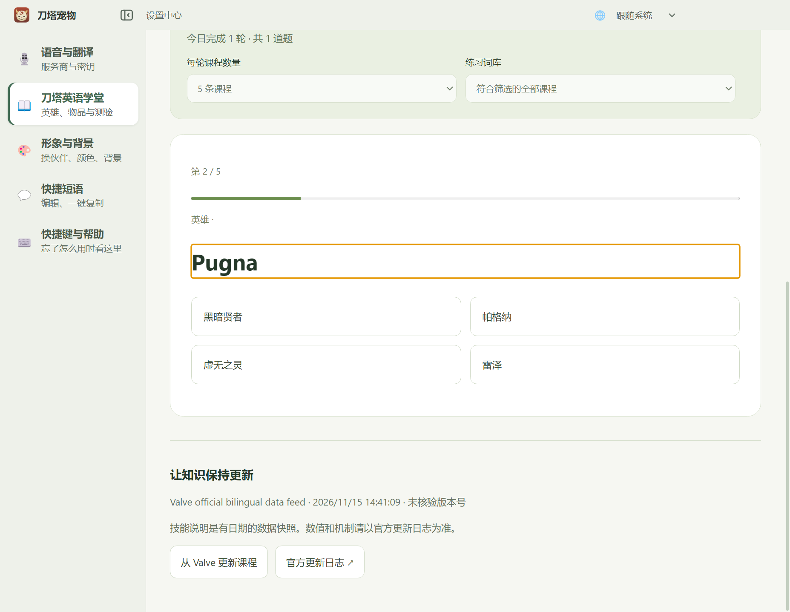
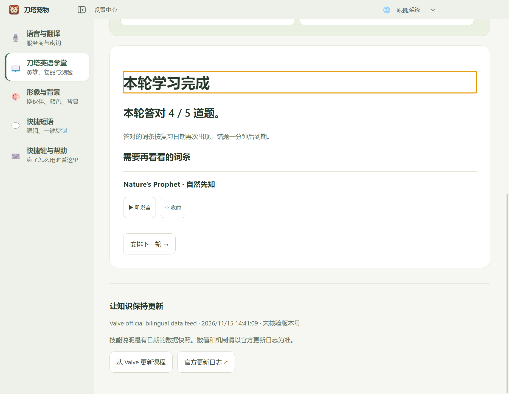

# Daily Dota English practice / 每日刀塔英语练习

## Start a session

1. Run the source build with `npm start` and open Settings with **Alt+S**.
2. Select **Dota English / 刀塔英语学堂** in the sidebar.
3. Open **Practice / 练习测验**.
4. Choose a topic and English → Chinese or Chinese → English. Optional search text narrows the eligible lessons.
5. Choose **5 lessons** or **10 lessons**, then **Start session**.

The session includes due mistakes first, then other due reviews, then new words. If fewer words are ready, it uses a shorter session. Future reviews stay on their scheduled date. You can complete more than one session per day; the selected length is a session size, not a daily lockout.

## Practice saved words

Open **My words / 我的词本** and choose **Practice my saved words / 练习我的收藏词条**. The Practice page selects the saved collection for you; choose the session length and start. You can also select **Saved words only** directly in Practice.

Only bookmarked lessons are selected. Topic and search filters still apply. Distractor choices may use other words from the same topic so even a single saved word can be quizzed. If no saved words are ready, save some lessons, broaden the filters or return when reviews are due.

## Pause and resume

Each submitted answer saves automatically. You may switch pages, close Settings or restart the app. Returning to Practice resumes the next unanswered question. The session's topic, direction, collection and size stay fixed until completion. There is one active session at a time.

## Complete and review

After the final answer, choose **See session summary / 查看学习总结**. The summary shows your score and the words you missed, with pronunciation and bookmark controls. Correct answers return after 1, 3, 7, 14 or 30 days according to your review level. Mistakes become due after one minute and can appear in a subsequent session.

The Practice panel counts completed sessions and answers for today using your computer's local date. It retains the latest 180 completed-session summaries. Individual word progress and the active session remain saved separately within the same state file.

## 中文说明

在「设置中心 → 刀塔英语学堂 → 练习测验」选择每轮 **5 条**或 **10 条**课程，设置主题和练习方向，再开始学习。系统优先安排到期错题，其次复习旧词，最后学习新词。可用词条不足时会自动缩短本轮，不会提前抽取尚未到期的复习词条。

在「我的词本」点击「练习我的收藏词条」，即可练习收藏词库；主题和搜索筛选仍然生效。每次答题自动保存，关闭设置或重启应用后可继续。本轮结束后可查看正确率和错题，听发音并收藏。每日可以学习多轮，桌面小伙伴继续保留。

## Local storage

Learning requires no AI key. Progress, preferences, session questions and completed-session history are stored in `learning-state.json` inside Electron's local `userData` directory. Earlier `learning-progress.json` data migrates on the first save and remains available in the old file. Use the current source build to continue recording progress after migration; older builds do not read the new state file.

## Verified previews

