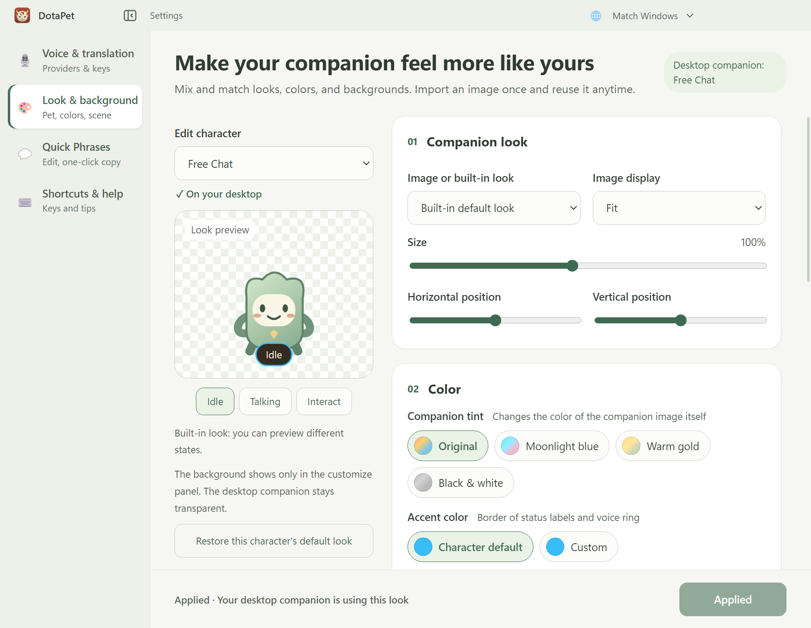

# Companion customization

Start the desktop companion with `npm start`. Right-click the companion (or the tray icon) and choose **设置中心**, then **形象与背景** in the sidebar. The page title, the character column and the apply bar stay still; only the settings column on the right scrolls, and the wheel scrolls it from anywhere on the page. The button to the right of the logo in the title bar folds the sidebar to icons with a short slide; the choice is remembered, and narrow windows always use icons. The pet's own **自定义** tab also has a button that opens this page.

## Choose and apply an appearance

1. Choose a hero, pet, or the free-chat companion under **编辑角色**.
2. Choose its built-in image or a picture from your library. Adjust fit, size and position while watching the preview.
3. Under **颜色**, **伙伴色调** recolors the companion image itself; **点缀色** sets the border of its status label and voice ring (角色默认, a color-only look, or **自选** for any color).
4. Choose a transparent, solid-color or image background. **只在自定义面板** keeps the desktop transparent; **桌面伙伴场景** adds the background behind the floating companion.
5. Click the button at the bottom right. For the companion on the desktop it reads **应用到桌面伙伴**; for another companion it reads **应用并换上此伙伴** (or **换上此伙伴** when nothing was edited) and also puts it on the desktop. It shows **已应用** when there is nothing to apply.

Preview edits remain local to the editor until applied. Switching between characters retains their unapplied drafts while the editor stays open. **恢复此角色的默认外观** previews the default; click Apply to finish restoring it. Cosmetic edits do not change the voice persona or provider.

## Give the companion a personality

Under **角色性格**, describe who the selected character is: personality, attitude, backstory and tone of voice (for example tsundere, sharp-tongued but caring). It applies with the same button as the look and is saved per character. Voice chat uses it in place of the built-in hero or pet persona, with a rule that it outranks the default tone; leave it empty to keep the default. Editing the companion already on the desktop takes effect from its next voice reply.

The persona describes the companion only. How it addresses you (**希望小伙伴怎么称呼你？** and chat preferences under **语音与翻译**) stays global and is still appended for every character. Restoring the default look and previewing a preset keep the persona; presets never carry one.

## Reuse pictures and presets

Import PNG, JPEG, GIF, WebP or SVG images up to 12 MB and 8192 pixels per side. Drag-and-drop has a role selector; file imports have separate companion and background buttons. Static images remain static across speaking and interaction states. Animated GIF/WebP files retain their own animation.

An imported file is copied into the app's data folder. The original can be moved later. Identical image bytes share one library entry, and the same entry can serve multiple characters and backgrounds. Rename and favorite entries in **我的图片**. Imports, names and favorites save immediately.

Deleting an image asks for confirmation and resets its references across saved characters and presets. Existing hero/pet selection and voice settings remain intact.

**保存当前搭配** saves a named preset from the current preview. **预览** loads it onto another character before applying. **导出** writes a portable JSON preset containing its required images; **导入预设** adds it to the library without applying it. Exports contain no credentials or installation-specific file paths. Character-specific artwork falls back to the receiving character's default when unavailable.

## Existing settings and artwork availability

On startup, legacy `voicespirit_custom_skins_*` uploads are copied from localStorage into the shared library and active selections are restored. Migration deduplicates images, retries failed imports and retains the original settings. Successfully migrated entries are tracked so restarting does not re-equip a deleted legacy image.

Catalog entries without distinct artwork are offered as **点缀色** choices, rather than equipped skins. Generic generated cosmetic placeholders are excluded from the editor. The cosmetics generator now emits the default for heroes without curated cosmetic entries. Existing catalog IDs remain readable for migration.

## Storage and verification

- Electron userData holds `customization.json` (schema version 1) and `customization-assets/` (content-addressed image files).
- Each profile is keyed by `hero:<id>` or `pet:<id>` and independently saves appearance, background, accent and persona (up to 2000 characters).
- `src/services/personaOverride.js` attaches a character's persona to the voice persona in the main process; `CloudVoiceEngine` puts it in place of the built-in lore.
- `src/services/appearance.js` provides the shared normalization, resolver and rendering rules.
- `src/main/customizationStore.js` owns durable storage, migration and preset portability. Renderer IPC restricts access to the local desktop/editor documents.
- `npm test` covers migration, persistence, deletion, validation and portable presets alongside the existing suite.
- `npm run smoke` exercises the real Electron editor, preload, IPC and desktop using a temporary data directory; it captures normal, narrow and library layouts without touching an existing companion or connecting to a voice provider.
